<p align="center">
  
</p>

<h1 align="center">Haizhu Infinity Canvas · 海柱无限画布</h1>

<p align="center"><b>给图片和视频创作者的无限节点画布。</b><br>
把你自己的文本、视觉、图片、视频和语音模型放到同一块画布上连线运行，从一句话做到带配音和字幕的成片；也可以让 Claude Code 帮你在画布上编排工作流。</p>

<p align="center">Windows · macOS · Linux · 网页版 / Docker · 多人网站 · Claude Code（MCP）</p>

<p align="center">
  <a href="#截图">截图</a> · <a href="#下载与安装">下载与安装</a> · <a href="./docs/03-guide/canvas-basics.md">使用指南</a> · <a href="./CHANGELOG.md">更新记录</a> · <a href="#english">English</a>
</p>

<p align="center">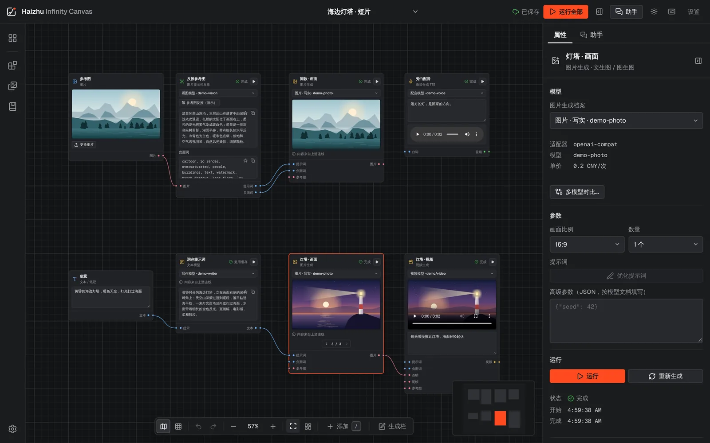</p>

- 当前版本：**v1.0.0-rc.18**（候选版，尚未打 tag；安装包见 GitHub Actions 的「Build installers」产物）
- 源码状态：**公开仓库（源码可见）**，但尚未授予开源许可，保留所有权利（见 [LICENSE](./LICENSE)）
- 目标平台：网页版（浏览器 / Docker，可开启注册登录部署成多人网站）· Windows 桌面版 · macOS 桌面版（Apple 芯片 / Intel）· Linux 桌面版（x64 / arm64）

## 截图

<table>
  <tr>
    <td width="50%">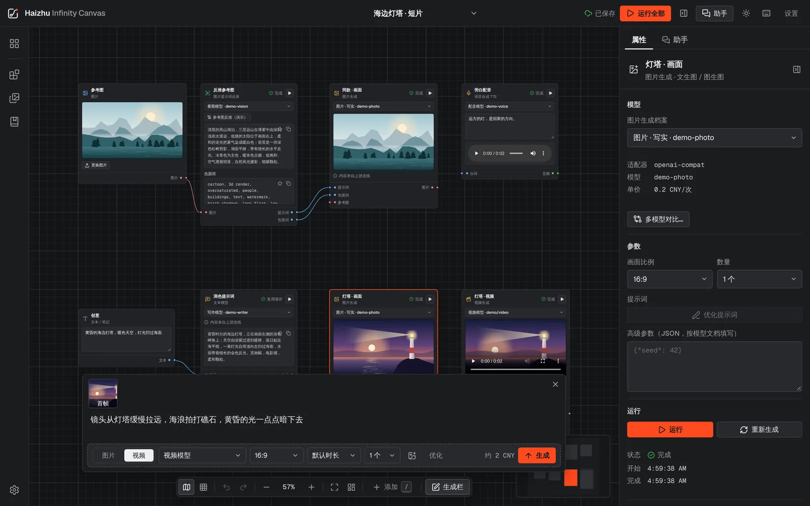<br><b>生成栏</b>：一句话加模型、比例、时长、数量就能生成；选中的图片自动作为首帧，结果是画布上的普通节点。</td>
    <td width="50%">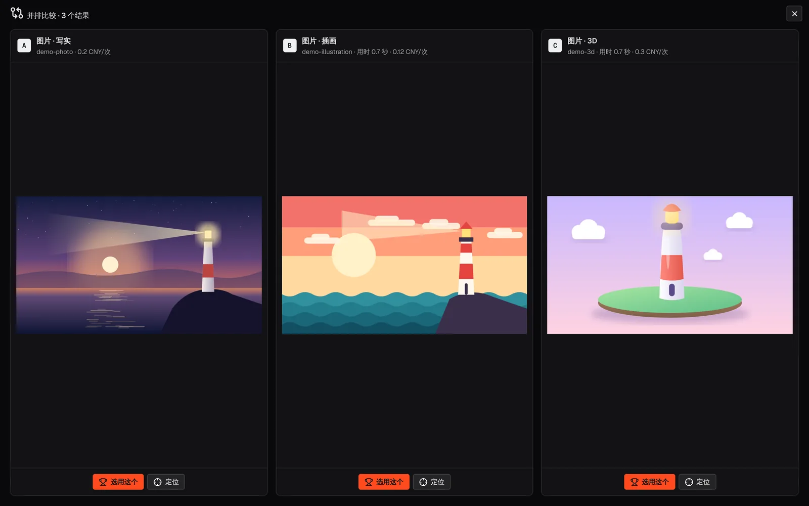<br><b>多模型对比</b>：同一段提示词交给几个模型，结果、用时和单价并排，选中的接管下游。</td>
  </tr>
  <tr>
    <td>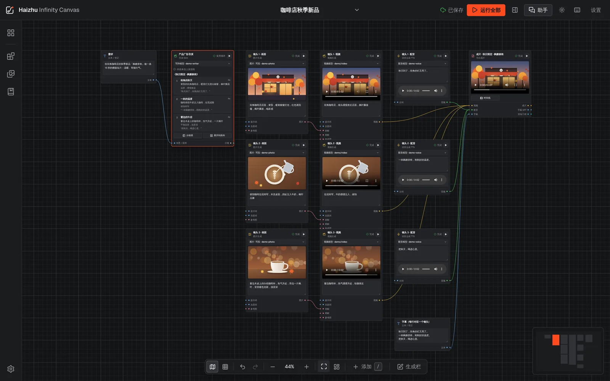<br><b>导演分镜</b>：一句创意拆成分镜，展开成每个镜头的画面、视频、配音，最后合成成片。</td>
    <td>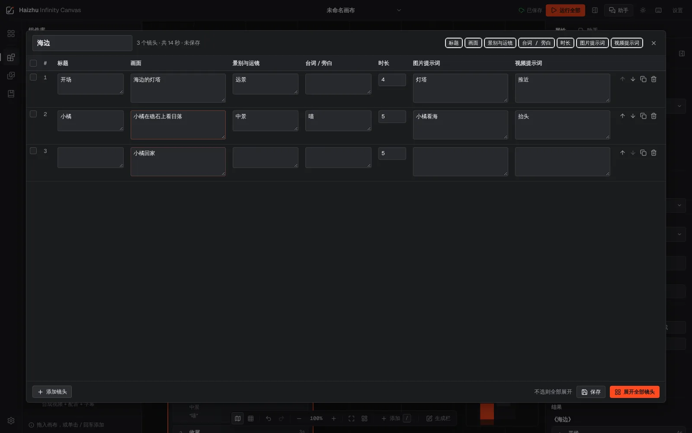<br><b>分镜表</b>：像表格一样改分镜，增删排序，保存为新版本，勾选几行只展开这几个镜头。</td>
  </tr>
  <tr>
    <td>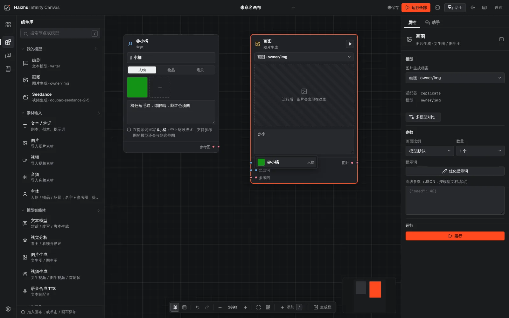<br><b>主体与 @ 引用</b>：给角色或商品起名并放参考图，提示词里 <code>@名字</code> 引用，多个镜头保持一致。</td>
    <td>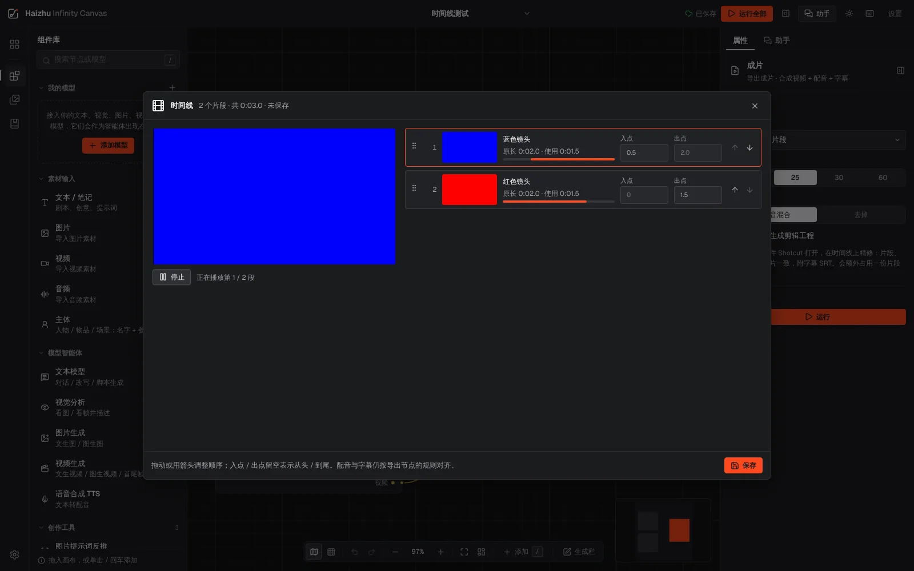<br><b>时间线</b>：导出节点上排好镜头顺序、剪掉头尾，整段预览后再合成成片和剪辑工程。</td>
  </tr>
  <tr>
    <td>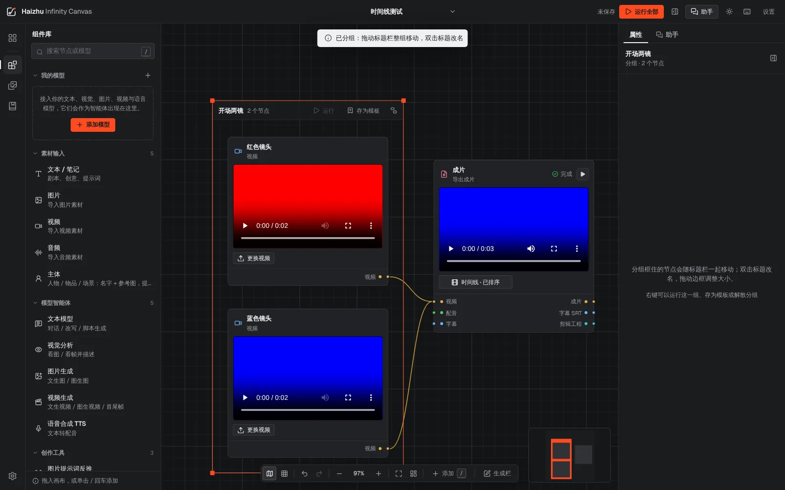<br><b>分组</b>：<code>Ctrl G</code> 把节点框成一组，整组移动、整组运行，存成「我的模板」随时插入。</td>
    <td>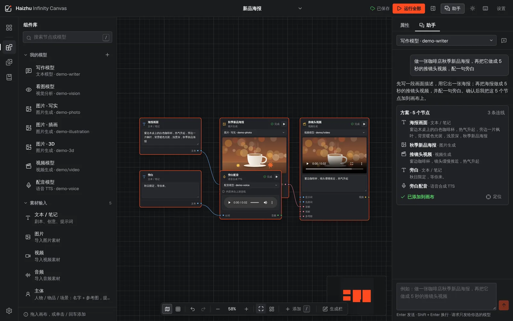<br><b>画布助手</b>：一句话描述要做的东西，助手给出节点方案，确认后才加到画布。</td>
  </tr>
  <tr>
    <td>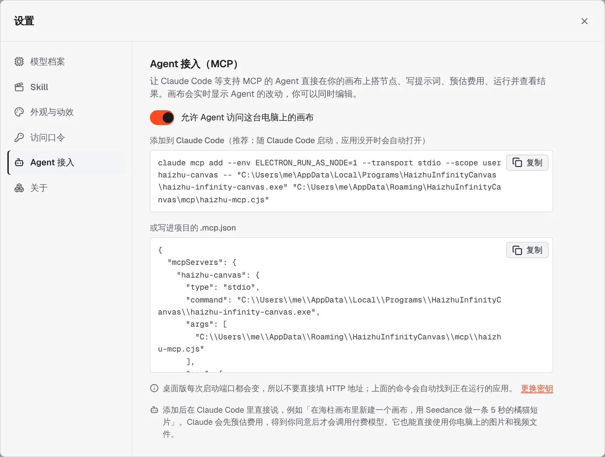<br><b>接入 Claude Code</b>：桌面版一条命令加到 Claude Code（MCP），应用没开时自动打开。</td>
    <td>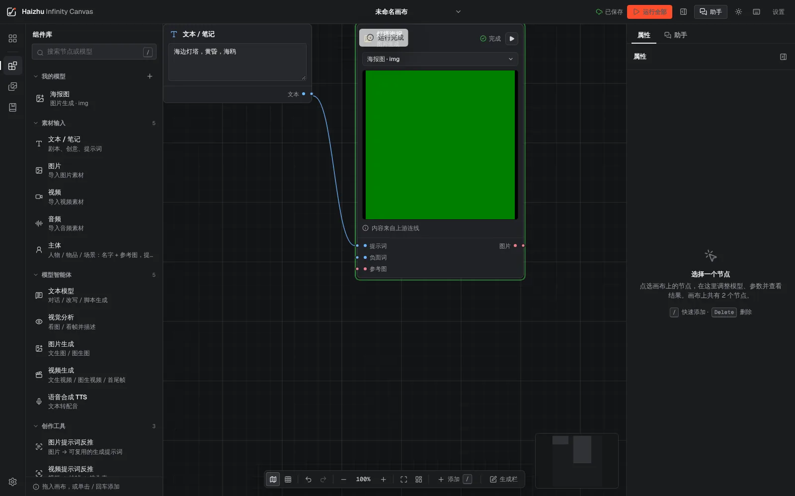<br><b>Agent 编排</b>：Claude 搭节点、写提示词，先报预估费用、同意后才运行；每一步实时出现在画布上。</td>
  </tr>
  <tr>
    <td>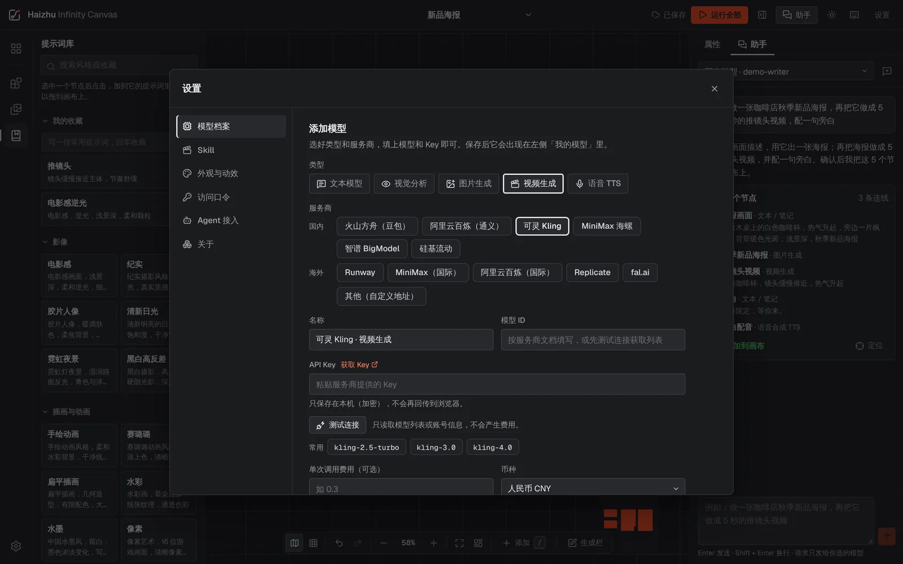<br><b>自带模型</b>：服务商按国内 / 海外 / 本机分组，选中后列出常用模型，测试连接不产生费用。</td>
    <td>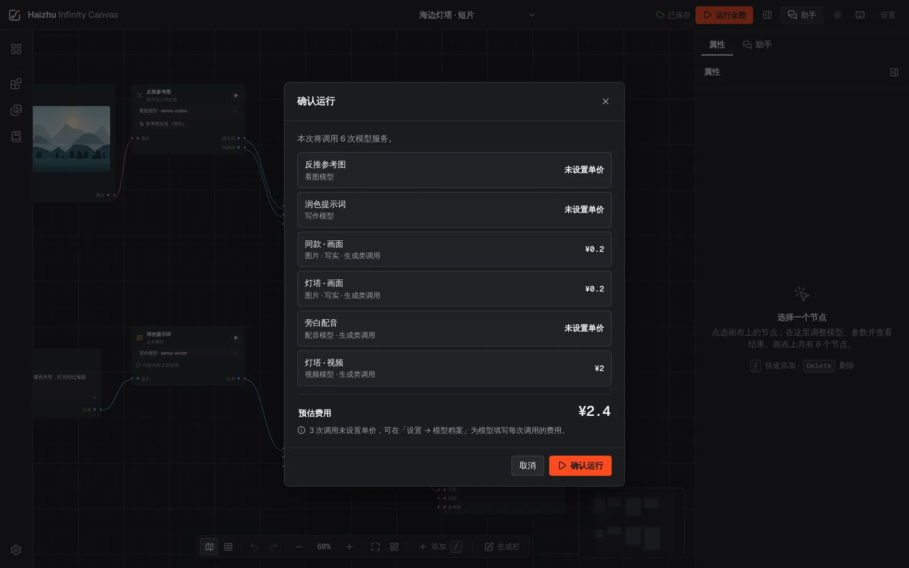<br><b>先看费用再运行</b>：这次会调用哪些模型、复用哪些结果、按你填的单价预估多少钱。</td>
  </tr>
</table>

<p align="center">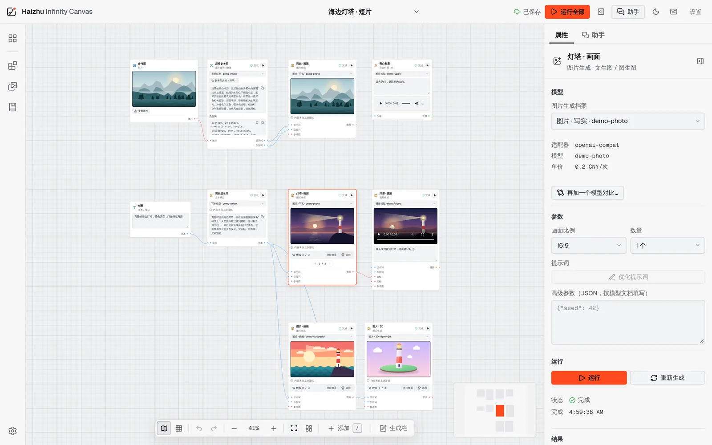<br>深色 / 浅色主题都有，界面用不带色偏的石墨灰，画布上唯一的颜色来自你的图片和视频。</p>

## 下载与安装

安装包由 GitHub Actions 的「[Build installers](https://github.com/HaizhuAI/HaizhuInfinityCanvas/actions/workflows/release.yml)」流水线构建：打开最新一次成功的运行，在页面底部的 Artifacts 里下载（尚未发布正式 Release）。

| 系统 | 文件 | 说明 |
| --- | --- | --- |
| Windows 10 / 11 | `…-win-x64-setup.exe`（安装版）· `…-win-x64-portable.exe`（便携版） | Windows on ARM 可直接运行 x64 版 |
| macOS 12+ | `…-mac-arm64.dmg`（Apple 芯片）· `…-mac-x64.dmg`（Intel） | 未公证：第一次打开时右键 → 打开 |
| Linux | `.AppImage` · `.deb`（x64 / arm64） | AppImage 需要 `chmod +x` |
| 网页版 / Docker | `docker compose up -d --build` | 设置 `HZC_TOKEN`；或开启账号模式部署成多人网站 |

视频反推与导出成片需要系统安装 FFmpeg（应用不内置），见[视频指南](./docs/03-guide/video-and-export.md)。让 Claude Code 操作画布见 [Agent 接入（MCP）](./docs/03-guide/agent-mcp.md)。

## 核心理念

1. **模型即图标**：在「设置 → 模型档案」里配好一次（接口地址、Key、模型名、默认参数），它就成为侧边栏里的一个可拖拽图标。
2. **连线即工作流**：节点有类型化端口（文本 / 图片 / 视频 / 音频 / 分镜 JSON），不兼容的线拉不出来；上游输出自动注入下游。不想接线时，用画布底部的**生成栏**一句话直接生成（一次可出 1–4 个再选用，结果仍是普通节点），还能「按目标模型优化提示词」、从视频最后一帧接着生成下一段。用**主体**节点给角色 / 商品起名并放参考图，在提示词里 `@名字` 引用，保持多个镜头一致；导演的分镜可以在**分镜表**里直接改。
3. **导演 Skill**：采用开放的 Agent Skills（`SKILL.md`）格式，导演 Skill 读剧本/创意 → 输出分镜 → 扇出成多个图片/视频节点。
4. **反推闭环**：图片提示词反推（内置模板，或一键导入 GitHub 上的反推 Skill，如 image-prompt-reverse）、视频提示词反推（抽帧 + 视觉模型 → 镜头表），正向提示词与负面词分别喂给生成节点。
5. **成片导出 + 剪辑工程**：画布内容 → FFmpeg 合成成片（拼接、配音、软字幕）；同时可导出与成片一致的 MLT 剪辑工程，用开源剪辑软件 Shotcut 在时间线上精修。
6. **接入常用服务商**：火山方舟 Seedance、阿里云百炼万相、可灵、MiniMax 海螺、智谱 CogVideoX、硅基流动、Runway、ElevenLabs 有专用适配器，OpenAI、Gemini、DeepSeek、Kimi 等走 OpenAI 兼容接口，也可接 Replicate / fal 和本机模型（见[接入各家模型服务商](./docs/03-guide/model-providers.md)）。
7. **本地优先 + 自带 Key**：项目与素材存本地，API Key 加密保存（桌面版的加密密钥交给系统钥匙串），成本透明、失败不乱扣费。
8. **项目包**：一个 `.hzc` 文件带走画布、素材与全部生成结果，换电脑或备份都不丢。
9. **安全与冗余**：网页部署防跨站请求、DNS 重绑定、SSRF 与令牌暴力猜测；数据库自动备份、损坏时自动从备份恢复，保存失败的修改留在浏览器里自动重试（见[部署指南](./docs/03-guide/projects-and-desktop.md#安全部署清单)）。
10. **可部署成网站（SaaS）**：开启账号模式后访客可注册登录，每人一个独立空间（自己的数据库与文件夹），自带模型 Key，管理员命令行管理账号（见[多人网站部署](./docs/03-guide/saas-deployment.md)）。
11. **让 Agent 操作画布（MCP）**：一条命令把桌面版加到 Claude Code，像本地 MCP 一样使用：让 Claude 搭节点、写提示词、预估费用、运行并查看结果，画布实时显示它的改动（见[Agent 接入](./docs/03-guide/agent-mcp.md)）。


## 文档导航

| 文档 | 内容 |
| --- | --- |
| [docs/00-research/01-landscape.md](./docs/00-research/01-landscape.md) | 竞品与开源项目调研 |
| [docs/00-research/02-license-audit.md](./docs/00-research/02-license-audit.md) | 许可证审计：哪些能用、哪些只能借鉴思路 |
| [docs/00-research/03-feasibility.md](./docs/00-research/03-feasibility.md) | 可行性结论与风险清单 |
| [docs/00-research/04-kaworkai-reference.md](./docs/00-research/04-kaworkai-reference.md) | 参考调研：咔作画布的交互思路，借鉴了什么、没有引入什么 |
| [docs/00-research/05-creative-platforms.md](./docs/00-research/05-creative-platforms.md) | 参考调研：Google Flow、即梦、LibTV、可灵、Runway、Krea、Flora、ComfyUI 等 30 余个图片 / 视频创作平台的交互规律与各模型提示词写法 |
| [docs/01-architecture/ADR-0001-tech-stack.md](./docs/01-architecture/ADR-0001-tech-stack.md) | 技术选型决策记录 |
| [docs/01-architecture/ADR-0002-ui-design-system.md](./docs/01-architecture/ADR-0002-ui-design-system.md) | 动效决策（GSAP / Galaxy / Taste Skill；配色与布局已由 ADR-0003 取代） |
| [docs/01-architecture/ADR-0003-studio-design-system.md](./docs/01-architecture/ADR-0003-studio-design-system.md) | 「工作室」设计系统：面向图片 / 视频创作者的内容优先界面（UI-UX-Pro-Max；配色字体已由 ADR-0005 取代） |
| [docs/01-architecture/ADR-0005-graphite-design-system.md](./docs/01-architecture/ADR-0005-graphite-design-system.md) | 「石墨」设计系统：去掉 AI 感（Galaxy 组件 + Taste Skill 准则；rc.11 起） |
| [docs/01-architecture/ADR-0004-editing-handoff.md](./docs/01-architecture/ADR-0004-editing-handoff.md) | 剪辑工坊：1.0 交付 Shotcut / MLT 剪辑工程，OpenReel 嵌入延后 |
| [docs/02-roadmap/roadmap.md](./docs/02-roadmap/roadmap.md) | 版本规划与里程碑 |
| [docs/02-roadmap/optimization-plan-2026-11.md](./docs/02-roadmap/optimization-plan-2026-11.md) | 优化方案（2026-11）：流畅、灵活、兼容、提示词与 Skill 的目标与 rc.14–rc.21 安排 |
| [docs/02-roadmap/build-matrix.md](./docs/02-roadmap/build-matrix.md) | Windows / macOS / Linux / 网页版的构建与启动测试 |
| [docs/brand/](./docs/brand/) | 标志（SVG 与应用图标） |
| [docs/03-guide/canvas-basics.md](./docs/03-guide/canvas-basics.md) | 使用指南：添加与编辑节点、画布助手、多模型对比、我的画布、提示词库、撤销 / 复制粘贴 / 右键菜单、快捷键、运行前检查与出错处理 |
| [docs/03-guide/model-profiles.md](./docs/03-guide/model-profiles.md) | 使用指南：添加模型与测试连接、提示词反推与反推 Skill、图片/视频/语音生成、费用预估 |
| [docs/03-guide/model-providers.md](./docs/03-guide/model-providers.md) | 使用指南：接入各家服务商（火山方舟、百炼万相、可灵、MiniMax、智谱、硅基流动、Runway、ElevenLabs、Gemini…）与参数怎么传 |
| [docs/03-guide/director-skills.md](./docs/03-guide/director-skills.md) | 使用指南：导演 Skill、分镜展开、快速添加 |
| [docs/03-guide/agent-mcp.md](./docs/03-guide/agent-mcp.md) | 使用指南：让 Claude Code 等 Agent 操作画布（MCP）：桌面版一条命令导入、WebUI / 多人网站用 HTTP + 密钥、工具列表、费用确认与安全 |
| [docs/03-guide/video-and-export.md](./docs/03-guide/video-and-export.md) | 使用指南：FFmpeg、视频提示词反推、导出成片、剪辑工程 |
| [docs/03-guide/projects-and-desktop.md](./docs/03-guide/projects-and-desktop.md) | 使用指南：项目包、桌面版数据与 API Key 保护、WebUI / Docker 部署、安全部署清单、数据备份与恢复 |
| [docs/03-guide/saas-deployment.md](./docs/03-guide/saas-deployment.md) | 使用指南：部署成多人使用的网站（注册登录、每人独立空间、管理命令、安全设计） |
| [THIRD_PARTY_NOTICES.md](./THIRD_PARTY_NOTICES.md) | 第三方依赖与借鉴来源登记 |
| [CHANGELOG.md](./CHANGELOG.md) | 变更记录（中文） |
| [CHANGELOG.en.md](./CHANGELOG.en.md) | Release notes (English) |

## 快速开始（开发）

需要 Node ≥ 22.13、pnpm 10。

```bash
pnpm install
pnpm dev                 # server :8787 + web :5173（web 代理 /api）
pnpm build && pnpm start # 构建后单进程运行：http://127.0.0.1:8787
pnpm test && pnpm typecheck
pnpm desktop:dev         # Electron 桌面壳（需 pnpm build 产物）
pnpm desktop:package     # 当前系统的安装包（Linux: AppImage + deb；Windows 请用 CI）
```

WebUI 容器部署：复制 `.env.example` 为 `.env` 并设置 `HZC_TOKEN`，然后 `docker compose up -d --build`。
服务端在非回环地址监听时**必须**设置 `HZC_TOKEN`，否则拒绝启动。

## 工作方式

- 每完成一个独立步骤就提交一次，并同步到远端开发分支 `claude/haizhu-infinity-canvas-research-m939uc`。
- 版本号遵循 SemVer，预发布标签：`v1.0.0-beta.N` → `v1.0.0-rc.N` → `v1.0.0`。

## English

**Haizhu Infinity Canvas** is an infinite node canvas for image and video creators. Bring your own models: text, vision, image, video and speech models become nodes you wire together, so one sentence can grow into a storyboard, pictures, video clips, voice-over and a finished film with subtitles.

- **Nodes and wires**: typed ports (text, image, video, audio, storyboard); generation results keep their versions.
- **Generate bar**: write one sentence, generate 1–4 variations, optimise the prompt for the target model, continue from a video's last frame.
- **Director skill and storyboard table**: an idea becomes shots, which expand into image, video and voice nodes.
- **Subjects**: name a character or product, give it reference pictures and mention it as `@name` to keep shots consistent.
- **Timeline and groups**: order and trim clips before export; frame nodes in groups and save them as templates.
- **Providers**: Volcano Ark (Seedance), Alibaba Bailian (Wan), Kling, MiniMax, Zhipu, SiliconFlow, Runway and ElevenLabs have native adapters. OpenAI-compatible APIs, Replicate, fal and local models (Ollama) also work.
- **Claude Code (MCP)**: one command adds the desktop app to Claude Code as a local MCP server. Claude builds nodes, writes prompts and estimates the cost; it only runs after you agree. The open canvas shows every change live. The web version connects over HTTP with a key.
- **Runs everywhere**: Windows, macOS (Apple silicon and Intel), Linux (x64 and arm64), web / Docker, and a multi-user site with sign-up and private workspaces.
- **Your data stays yours**: projects live locally, API keys are encrypted (desktop: OS keychain), and backups and recovery are built in.

Release notes in English: [CHANGELOG.en.md](./CHANGELOG.en.md). The guides in `docs/` are in Chinese.
